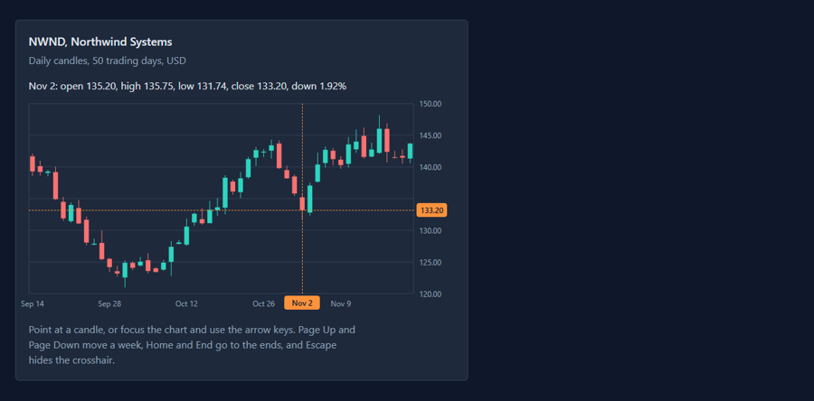
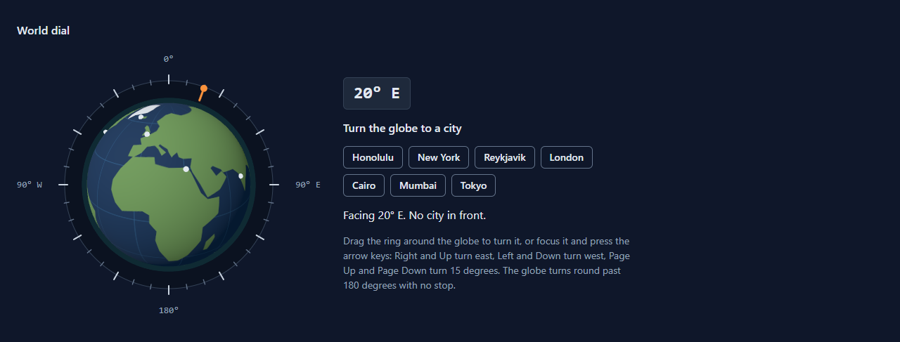
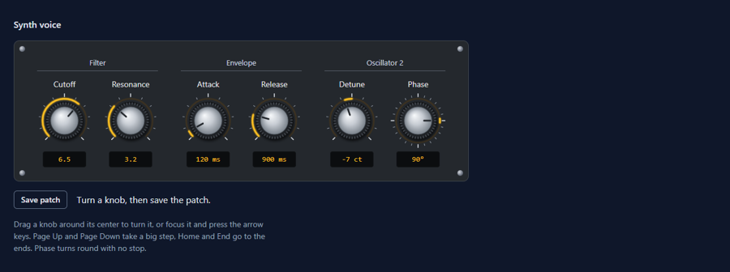
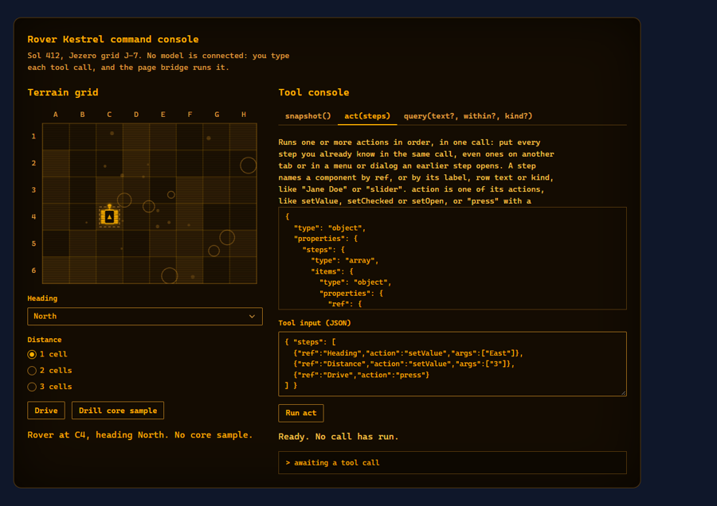
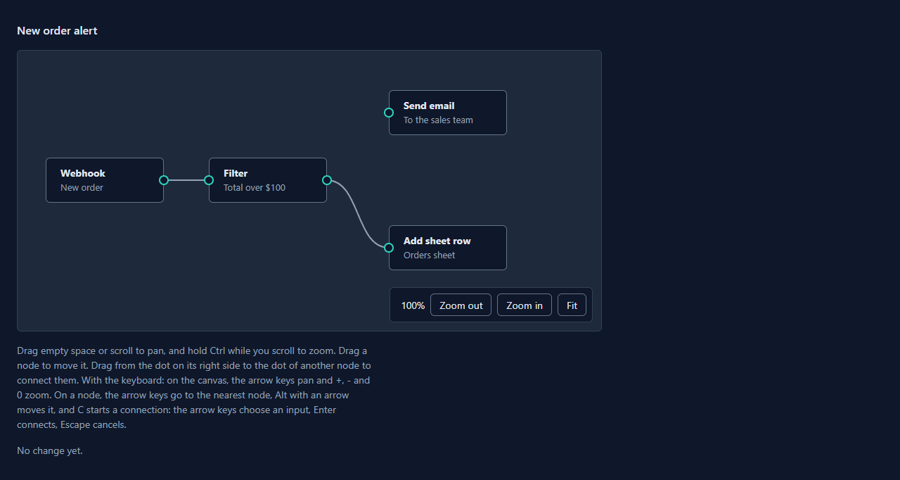
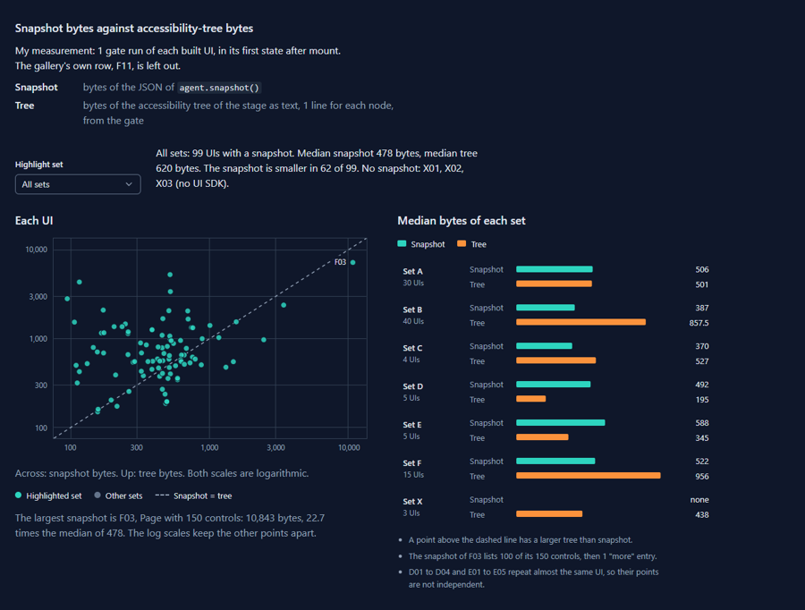

# UI SDK gallery: 103 UIs on 3 orthogonal axes

100 demo UIs built with [UI SDK](https://ui-sdk.dev/) (`@ui-sdk/*` `0.1.0-beta.16`), and 3 comparison builds without it. Each UI has tests, a screenshot and a result file from a 7-stage gate. Each UI also connects to the SDK's agent bridge, so that an agent can use it through its components. The 3 comparison builds have no bridge.

This is an independent project. It is not a Vercel product. UI SDK is in beta, and its APIs can change.

| | |
| --- | --- |
| [](shots/C01.png) C01: a crosshair behavior that the package does not ship | [](shots/C04.png) C04: a three.js globe on a new rotary behavior |
| [](shots/C03.png) C03: synth knobs on the same rotary behavior | [](shots/F05.png) F05: a person types the agent tool calls |
| [](shots/B06.png) B06: pan, zoom, move and connect | [](shots/F11.png) F11: snapshot bytes against accessibility-tree bytes |

Select a picture to see the full screenshot with the card of that UI. `shots/` holds all 103.

## Sources

- Better Stack, [Shadcn Just Rebuilt UI for AI Agents (UI SDK)](https://www.youtube.com/watch?v=ubK6Q53jKg8) (video)
- shadcn, [the launch post of UI SDK](https://x.com/shadcn/status/2120951116682682646) (X)
- [vercel-labs/ui](https://github.com/vercel-labs/ui) (GitHub, Apache 2.0)
- [ui-sdk.dev](https://ui-sdk.dev/)

## The 3 orthogonal axes

Each UI has a position on 3 axes:

- **Axis 1, role:** Build (an agent makes the UI) or Use (an agent operates the UI).
- **Axis 2, kind of help:** Mechanism, Knowledge, Check or Control.
- **Axis 3, layer:** the lowest layer where the UI needs its own code. 1 behavior, 2 primitive, 3 parts, 4 complete part, 5 style.

## The sets

| Set | UIs | Contents |
| --- | --- | --- |
| A | 30 | Shipped components only |
| B | 40 | Primitives made from shipped behaviors |
| C | 4 | 2 behaviors that the package does not ship, each in 2 UIs |
| D | 5 | 1 primitive through the React, Vue, Svelte and Solid adapters, and 5 renderings on 1 page |
| E | 5 | UI A01 with 5 different looks |
| F | 16 | Agent use: the bridge, self-description, measurement and control |
| X | 3 | Comparison builds of A01, B01 and B17 without UI SDK |

`rows.json` holds 1 row for each UI: title, set, layer, what it shows, and the model and effort planned for its builder.

## Run it

Tested on Windows 11 with Node `v22.22.0`. `npm ci` prints an `EBADENGINE` warning for this version, because `jsdom` asks for `^22.22.2`, `^24.15.0` or `>=26.0.0`.

```
npm ci
npm run build
```

Then open `dist/index.html` in Chrome. A web server is not necessary. Add `?ui=C04` to the address to open 1 UI. `dist/gallery.js` is about 4.3 MB.

| Command | Use |
| --- | --- |
| `npm run rows` | Check `rows.json` against the installed packages. `npm run rows -- B06` prints 1 row. |
| `npm test` | Run the Vitest suite. See "Known limits". |
| `npm run gate -- B06` | Run the gate on 1 UI. |
| `npm run check` | Run the gate on all UIs. |

The gate needs 2 programs that `npm ci` does not install: Google Chrome (set `CHROME` if it is not in the default Windows folder) and the detector of the `impeccable` skill (set `IMPECCABLE` to its path).

## The gate

| Stage | What it checks |
| --- | --- |
| source | The files, and the imports against `rows.json` |
| types | `tsc` on the files of the UI |
| tests | Vitest, with required test names |
| build | A build that holds only that UI |
| browser | Console, snapshot labels, Tab walk, axe WCAG A and AA, a scripted agent task, screenshot |
| design | `impeccable detect` with 0 findings (A09 has 1 recorded exception) |
| breaks | For layer 1 and 2 UIs: each deliberate break must make its named test fail |

## A measurement

This is a measurement of this gallery, not a Vercel benchmark. It covers 99 UIs in their first state after mount. F11 and the 3 comparison builds are not in it.

| | Median bytes |
| --- | --- |
| Bridge snapshot, `agent.snapshot()` | 478 |
| Accessibility tree as text, 1 line for each node | 620 |

The snapshot is smaller in 62 of the 99 UIs. It is larger or equal in the other 37. Thus the bridge does not always send less text than the accessibility tree.

## Known limits

- `npm test` exits with code 1 on a fresh clone: 1,072 tests pass and 1 test is an expected failure, but Vitest reports 8 unhandled errors. All 8 come from `ui/B25-tag-list.test.ts`: `ReferenceError: WebKitCSSMatrix is not defined`, from `d3` in `jsdom`.
- The gate does not check layout, a screen reader, a real phone or touch input. axe checks contrast only in the first state.
- Some behaviors were checked only in `jsdom`, not in a real browser.
- With the Vue, Svelte and Solid adapters, the empty part shows under a full list at mount (seen in `jsdom` only). Each of those UI files has a workaround.
- The C03 and C04 arrow keys do not mirror in right-to-left text.
- The test in `ui/A23-flight-search.test.ts` uses real waits of 260 ms and can fail on a slow computer.

## Files

| Path | Contents |
| --- | --- |
| `ui/` | 2 files for each UI: the UI and its tests |
| `src/` | The page shell, the 2 new behaviors and test helpers |
| `scripts/` | Build, gate, rows and review scripts |
| `shots/`, `results/` | The screenshot and the gate numbers of each UI |
| `BUILDER.md`, `IMPLEMENTATION.md` | The instructions that the builder agents and the orchestrator followed |

Claude Code agents built the gallery. The commit messages name the models in their `Co-Authored-By` lines.
