# UI SDK gallery: 103 UIs on 3 orthogonal axes

100 demo UIs built with [UI SDK](https://ui-sdk.dev/) (`@ui-sdk/*` `0.1.0-beta.16`), and 3 comparison builds without it. Each UI has tests, a screenshot and a result file from a 7-stage gate. Each UI also connects to the SDK's agent bridge, so that an agent can use it through its components. The 3 comparison builds have no bridge.

This is an independent project. It is not a Vercel product. UI SDK is in beta, and its APIs can change.

**[Play with all 103 UIs live](https://az9713.github.io/ui-sdk-gallery/)** — [grid with filter](https://az9713.github.io/ui-sdk-gallery/review.html) · [UI SDK explained](https://az9713.github.io/ui-sdk-gallery/explainer.html) · [the plan for the 100 UIs](https://az9713.github.io/ui-sdk-gallery/plan.html)

Each picture in "The 103 UIs" below opens that UI live.

## Sources

- Better Stack, [Shadcn Just Rebuilt UI for AI Agents (UI SDK)](https://www.youtube.com/watch?v=ubK6Q53jKg8) (video)
- shadcn, [the launch post of UI SDK](https://x.com/shadcn/status/2120951116682682646) (X)
- [vercel-labs/ui](https://github.com/vercel-labs/ui) (GitHub, Apache 2.0)
- [ui-sdk.dev](https://ui-sdk.dev/)

## The 3 orthogonal axes

Each UI has a position on 3 axes:

- **Axis 1, role:** Build (an agent makes the UI) or Use (an agent operates the UI).
- **Axis 2, kind of help:** Mechanism, Knowledge, Check or Control.
- **Axis 3, layer:** the lowest layer where the UI needs its own code. 1 behavior, 2 primitive, 3 parts, 4 complete part, 5 style.

## The sets

| Set | UIs | Contents |
| --- | --- | --- |
| A | 30 | Shipped components only |
| B | 40 | Primitives made from shipped behaviors |
| C | 4 | 2 behaviors that the package does not ship, each in 2 UIs |
| D | 5 | 1 primitive through the React, Vue, Svelte and Solid adapters, and 5 renderings on 1 page |
| E | 5 | UI A01 with 5 different looks |
| F | 16 | Agent use: the bridge, self-description, measurement and control |
| X | 3 | Comparison builds of A01, B01 and B17 without UI SDK |

`rows.json` holds 1 row for each UI: title, set, layer, what it shows, and the model and effort planned for its builder.

## The 103 UIs

Select a picture or a title to open the UI. Use the mouse or the keyboard. The card under each UI has its tests and a button that runs an agent task. The button is off in the 3 comparison builds (set X), which have no agent task.

<!-- grid:start -->

### Set A: Shipped components only (30)

<table>
<tr>
<td width="33%" valign="top"><a href="https://az9713.github.io/ui-sdk-gallery/?ui=A01">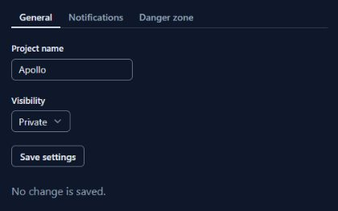</a><br><b>A01</b> <a href="https://az9713.github.io/ui-sdk-gallery/?ui=A01">Project settings, 3 tabs</a><br><sub>A settings page from shipped components, with a confirm dialog</sub></td>
<td width="33%" valign="top"><a href="https://az9713.github.io/ui-sdk-gallery/?ui=A02">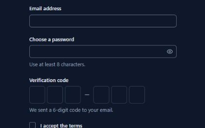</a><br><b>A02</b> <a href="https://az9713.github.io/ui-sdk-gallery/?ui=A02">Sign-up with a one-time code</a><br><sub>Password and one-time-code fields, which the bridge treats as secret</sub></td>
<td width="33%" valign="top"><a href="https://az9713.github.io/ui-sdk-gallery/?ui=A03">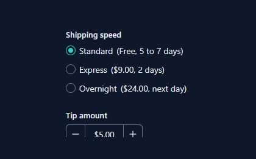</a><br><b>A03</b> <a href="https://az9713.github.io/ui-sdk-gallery/?ui=A03">Checkout</a><br><sub>A radio group and a money field with step 0.01</sub></td>
</tr>
<tr>
<td width="33%" valign="top"><a href="https://az9713.github.io/ui-sdk-gallery/?ui=A04">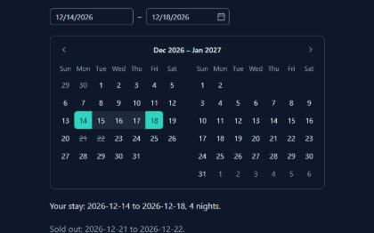</a><br><b>A04</b> <a href="https://az9713.github.io/ui-sdk-gallery/?ui=A04">Hotel booking, date range</a><br><sub>A date range in a picker and an inline month grid</sub></td>
<td width="33%" valign="top"><a href="https://az9713.github.io/ui-sdk-gallery/?ui=A05">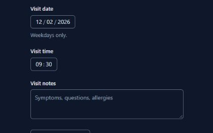</a><br><b>A05</b> <a href="https://az9713.github.io/ui-sdk-gallery/?ui=A05">Clinic appointment</a><br><sub>Typed date and time segments, and a notes field</sub></td>
<td width="33%" valign="top"><a href="https://az9713.github.io/ui-sdk-gallery/?ui=A06">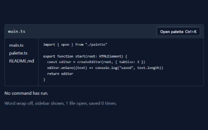</a><br><b>A06</b> <a href="https://az9713.github.io/ui-sdk-gallery/?ui=A06">Command palette for an editor</a><br><sub>Search and run commands in a dialog</sub></td>
</tr>
<tr>
<td width="33%" valign="top"><a href="https://az9713.github.io/ui-sdk-gallery/?ui=A07">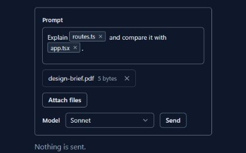</a><br><b>A07</b> <a href="https://az9713.github.io/ui-sdk-gallery/?ui=A07">Prompt box with files and a model</a><br><sub>Tokens in text, an @ menu, and file attachments</sub></td>
<td width="33%" valign="top"><a href="https://az9713.github.io/ui-sdk-gallery/?ui=A08">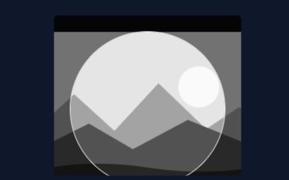</a><br><b>A08</b> <a href="https://az9713.github.io/ui-sdk-gallery/?ui=A08">Profile photo upload</a><br><sub>Crop an image with a zoom slider and show it as an avatar</sub></td>
<td width="33%" valign="top"><a href="https://az9713.github.io/ui-sdk-gallery/?ui=A09">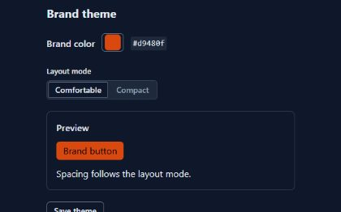</a><br><b>A09</b> <a href="https://az9713.github.io/ui-sdk-gallery/?ui=A09">Brand theme editor</a><br><sub>A color picker in a popover and a compact mode switch</sub></td>
</tr>
<tr>
<td width="33%" valign="top"><a href="https://az9713.github.io/ui-sdk-gallery/?ui=A10">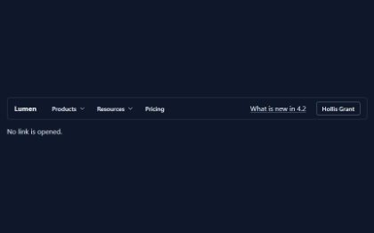</a><br><b>A10</b> <a href="https://az9713.github.io/ui-sdk-gallery/?ui=A10">Site header</a><br><sub>Navigation panels, a link preview and an account menu</sub></td>
<td width="33%" valign="top"><a href="https://az9713.github.io/ui-sdk-gallery/?ui=A11">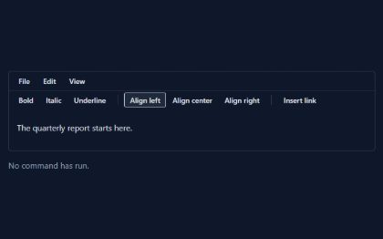</a><br><b>A11</b> <a href="https://az9713.github.io/ui-sdk-gallery/?ui=A11">Document editor top area</a><br><sub>An application menu bar and a toolbar with 1 tab stop</sub></td>
<td width="33%" valign="top"><a href="https://az9713.github.io/ui-sdk-gallery/?ui=A12">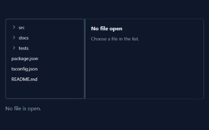</a><br><b>A12</b> <a href="https://az9713.github.io/ui-sdk-gallery/?ui=A12">File explorer</a><br><sub>A tree in a resizable, scrollable pane</sub></td>
</tr>
<tr>
<td width="33%" valign="top"><a href="https://az9713.github.io/ui-sdk-gallery/?ui=A13">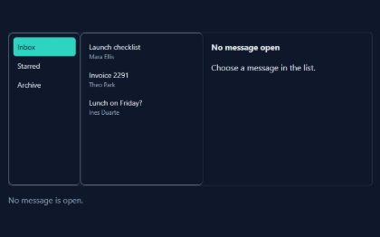</a><br><b>A13</b> <a href="https://az9713.github.io/ui-sdk-gallery/?ui=A13">Mail client with 3 panes</a><br><sub>Always-visible lists that drive a reading pane</sub></td>
<td width="33%" valign="top"><a href="https://az9713.github.io/ui-sdk-gallery/?ui=A14">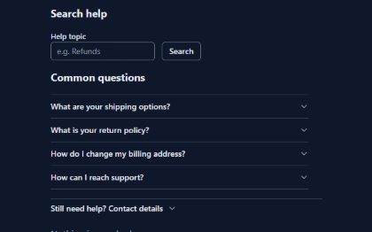</a><br><b>A14</b> <a href="https://az9713.github.io/ui-sdk-gallery/?ui=A14">Help center</a><br><sub>Sections that open, and free text with suggestions</sub></td>
<td width="33%" valign="top"><a href="https://az9713.github.io/ui-sdk-gallery/?ui=A15">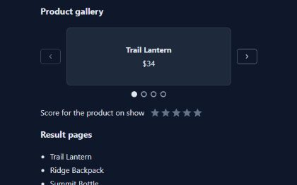</a><br><b>A15</b> <a href="https://az9713.github.io/ui-sdk-gallery/?ui=A15">Product gallery</a><br><sub>Slides, a score and result pages</sub></td>
</tr>
<tr>
<td width="33%" valign="top"><a href="https://az9713.github.io/ui-sdk-gallery/?ui=A16">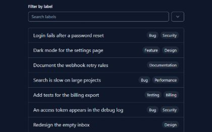</a><br><b>A16</b> <a href="https://az9713.github.io/ui-sdk-gallery/?ui=A16">Issue list with filters</a><br><sub>Search a list and choose several filters</sub></td>
<td width="33%" valign="top"><a href="https://az9713.github.io/ui-sdk-gallery/?ui=A17">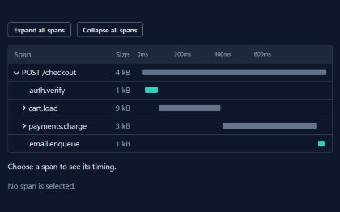</a><br><b>A17</b> <a href="https://az9713.github.io/ui-sdk-gallery/?ui=A17">Request trace viewer</a><br><sub>Request timings on a time axis</sub></td>
<td width="33%" valign="top"><a href="https://az9713.github.io/ui-sdk-gallery/?ui=A18">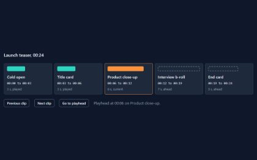</a><br><b>A18</b> <a href="https://az9713.github.io/ui-sdk-gallery/?ui=A18">Video clip timeline</a><br><sub>Clips on a timeline</sub></td>
</tr>
<tr>
<td width="33%" valign="top"><a href="https://az9713.github.io/ui-sdk-gallery/?ui=A19">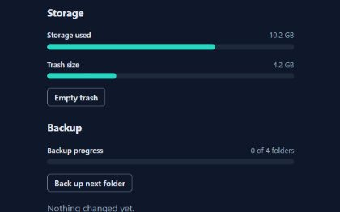</a><br><b>A19</b> <a href="https://az9713.github.io/ui-sdk-gallery/?ui=A19">Storage dashboard</a><br><sub>Measurements in a range and task progress</sub></td>
<td width="33%" valign="top"><a href="https://az9713.github.io/ui-sdk-gallery/?ui=A20">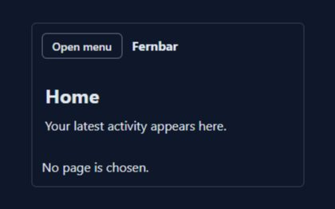</a><br><b>A20</b> <a href="https://az9713.github.io/ui-sdk-gallery/?ui=A20">Phone navigation drawer</a><br><sub>A drawer from an edge</sub></td>
<td width="33%" valign="top"><a href="https://az9713.github.io/ui-sdk-gallery/?ui=A21">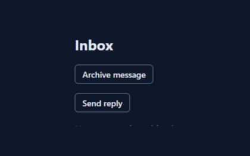</a><br><b>A21</b> <a href="https://az9713.github.io/ui-sdk-gallery/?ui=A21">Notification center</a><br><sub>Toasts with an action</sub></td>
</tr>
<tr>
<td width="33%" valign="top"><a href="https://az9713.github.io/ui-sdk-gallery/?ui=A22">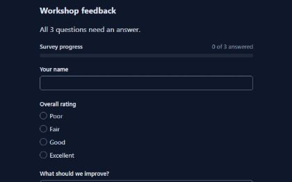</a><br><b>A22</b> <a href="https://az9713.github.io/ui-sdk-gallery/?ui=A22">Survey with a progress bar</a><br><sub>Native form submit, required-field errors and reset (docs/forms.md)</sub></td>
<td width="33%" valign="top"><a href="https://az9713.github.io/ui-sdk-gallery/?ui=A23">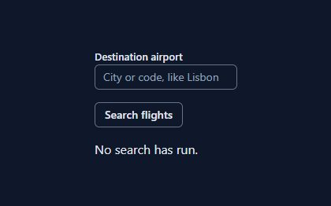</a><br><b>A23</b> <a href="https://az9713.github.io/ui-sdk-gallery/?ui=A23">Flight search</a><br><sub>Autocomplete with options that load after a delay</sub></td>
<td width="33%" valign="top"><a href="https://az9713.github.io/ui-sdk-gallery/?ui=A24">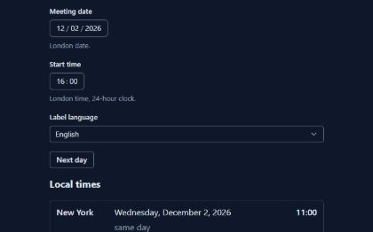</a><br><b>A24</b> <a href="https://az9713.github.io/ui-sdk-gallery/?ui=A24">Meeting planner for 3 time zones</a><br><sub>Date arithmetic and localized labels from @ui-sdk/core/date</sub></td>
</tr>
<tr>
<td width="33%" valign="top"><a href="https://az9713.github.io/ui-sdk-gallery/?ui=A25">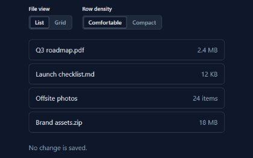</a><br><b>A25</b> <a href="https://az9713.github.io/ui-sdk-gallery/?ui=A25">Display preferences</a><br><sub>The preferences component</sub></td>
<td width="33%" valign="top"><a href="https://az9713.github.io/ui-sdk-gallery/?ui=A26">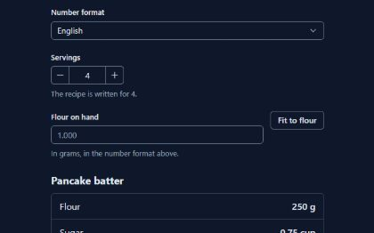</a><br><b>A26</b> <a href="https://az9713.github.io/ui-sdk-gallery/?ui=A26">Recipe scaler</a><br><sub>Steps, format and parse from @ui-sdk/core/number</sub></td>
<td width="33%" valign="top"><a href="https://az9713.github.io/ui-sdk-gallery/?ui=A27">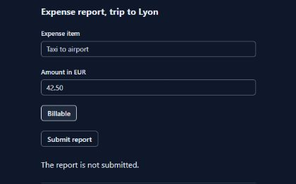</a><br><b>A27</b> <a href="https://az9713.github.io/ui-sdk-gallery/?ui=A27">Expense report</a><br><sub>Server markup first, then the elements start (docs/server-rendering.md)</sub></td>
</tr>
<tr>
<td width="33%" valign="top"><a href="https://az9713.github.io/ui-sdk-gallery/?ui=A28">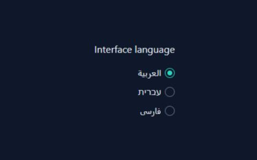</a><br><b>A28</b> <a href="https://az9713.github.io/ui-sdk-gallery/?ui=A28">Language picker, right to left</a><br><sub>Right-to-left layout with no direction provider</sub></td>
<td width="33%" valign="top"><a href="https://az9713.github.io/ui-sdk-gallery/?ui=A29">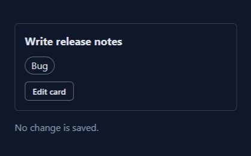</a><br><b>A29</b> <a href="https://az9713.github.io/ui-sdk-gallery/?ui=A29">Task card editor in a dialog</a><br><sub>4 nested layers. Escape closes 1 layer each time.</sub></td>
<td width="33%" valign="top"><a href="https://az9713.github.io/ui-sdk-gallery/?ui=A30">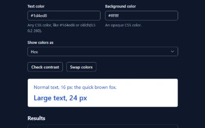</a><br><b>A30</b> <a href="https://az9713.github.io/ui-sdk-gallery/?ui=A30">Palette contrast checker</a><br><sub>Colors as data from @ui-sdk/core/color: parse, convert, contrastRatio</sub></td>
</tr>
</table>

### Set B: Primitives made from shipped behaviors (40)

<table>
<tr>
<td width="33%" valign="top"><a href="https://az9713.github.io/ui-sdk-gallery/?ui=B01">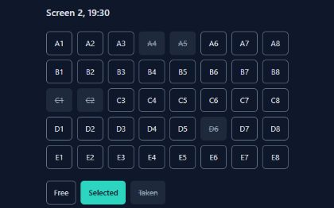</a><br><b>B01</b> <a href="https://az9713.github.io/ui-sdk-gallery/?ui=B01">Cinema seat map</a><br><sub>A grid of seats with 1 tab stop, taken seats that focus skips, and multiple selection</sub></td>
<td width="33%" valign="top"><a href="https://az9713.github.io/ui-sdk-gallery/?ui=B02">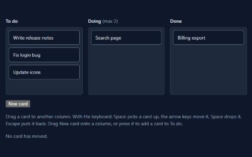</a><br><b>B02</b> <a href="https://az9713.github.io/ui-sdk-gallery/?ui=B02">Card board with columns</a><br><sub>Drag cards between columns, by pointer and by keyboard</sub></td>
<td width="33%" valign="top"><a href="https://az9713.github.io/ui-sdk-gallery/?ui=B03">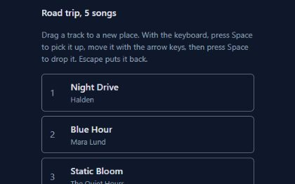</a><br><b>B03</b> <a href="https://az9713.github.io/ui-sdk-gallery/?ui=B03">Playlist that you reorder</a><br><sub>Reorder a list by drag and by keyboard</sub></td>
</tr>
<tr>
<td width="33%" valign="top"><a href="https://az9713.github.io/ui-sdk-gallery/?ui=B04">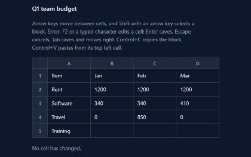</a><br><b>B04</b> <a href="https://az9713.github.io/ui-sdk-gallery/?ui=B04">Spreadsheet</a><br><sub>A block of cells, edit in place, copy and paste</sub></td>
<td width="33%" valign="top"><a href="https://az9713.github.io/ui-sdk-gallery/?ui=B05">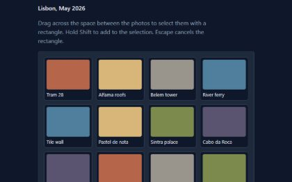</a><br><b>B05</b> <a href="https://az9713.github.io/ui-sdk-gallery/?ui=B05">Photo grid, select with a rectangle</a><br><sub>Rectangle selection</sub></td>
<td width="33%" valign="top"><a href="https://az9713.github.io/ui-sdk-gallery/?ui=B06">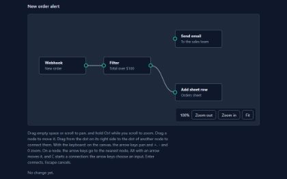</a><br><b>B06</b> <a href="https://az9713.github.io/ui-sdk-gallery/?ui=B06">Workflow node editor</a><br><sub>Pan and zoom a canvas, move nodes, connect ports</sub></td>
</tr>
<tr>
<td width="33%" valign="top"><a href="https://az9713.github.io/ui-sdk-gallery/?ui=B07">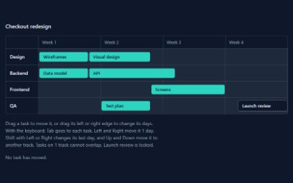</a><br><b>B07</b> <a href="https://az9713.github.io/ui-sdk-gallery/?ui=B07">Project plan on tracks</a><br><sub>Spans on tracks that you move and resize</sub></td>
<td width="33%" valign="top"><a href="https://az9713.github.io/ui-sdk-gallery/?ui=B08">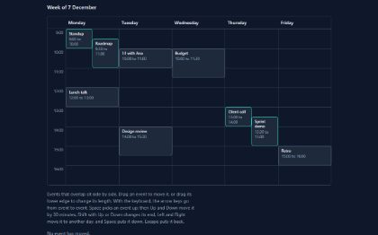</a><br><b>B08</b> <a href="https://az9713.github.io/ui-sdk-gallery/?ui=B08">Week calendar</a><br><sub>Events that overlap, placed side by side</sub></td>
<td width="33%" valign="top"><a href="https://az9713.github.io/ui-sdk-gallery/?ui=B09">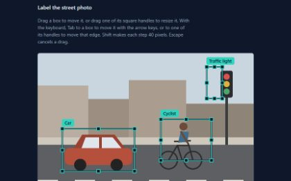</a><br><b>B09</b> <a href="https://az9713.github.io/ui-sdk-gallery/?ui=B09">Image annotation boxes</a><br><sub>Boxes with resize handles</sub></td>
</tr>
<tr>
<td width="33%" valign="top"><a href="https://az9713.github.io/ui-sdk-gallery/?ui=B10">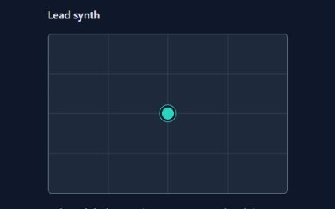</a><br><b>B10</b> <a href="https://az9713.github.io/ui-sdk-gallery/?ui=B10">Sound pad with 2 axes</a><br><sub>A 2-axis control</sub></td>
<td width="33%" valign="top"><a href="https://az9713.github.io/ui-sdk-gallery/?ui=B11">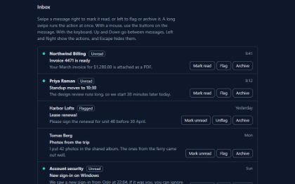</a><br><b>B11</b> <a href="https://az9713.github.io/ui-sdk-gallery/?ui=B11">Inbox with swipe actions</a><br><sub>Swipe a row for actions. Buttons for a mouse.</sub></td>
<td width="33%" valign="top"><a href="https://az9713.github.io/ui-sdk-gallery/?ui=B12">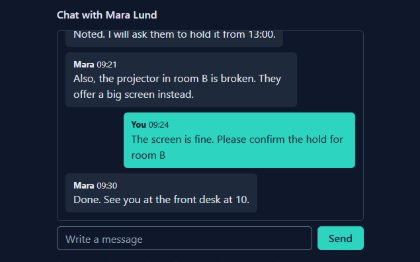</a><br><b>B12</b> <a href="https://az9713.github.io/ui-sdk-gallery/?ui=B12">Chat thread</a><br><sub>A list that stays at the bottom, and ArrowUp for earlier messages</sub></td>
</tr>
<tr>
<td width="33%" valign="top"><a href="https://az9713.github.io/ui-sdk-gallery/?ui=B13">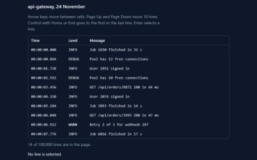</a><br><b>B13</b> <a href="https://az9713.github.io/ui-sdk-gallery/?ui=B13">Log viewer with 100,000 rows</a><br><sub>Only the visible rows are rendered</sub></td>
<td width="33%" valign="top"><a href="https://az9713.github.io/ui-sdk-gallery/?ui=B14">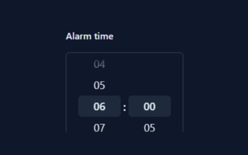</a><br><b>B14</b> <a href="https://az9713.github.io/ui-sdk-gallery/?ui=B14">Time wheel</a><br><sub>A listbox that you scroll to pick from</sub></td>
<td width="33%" valign="top"><a href="https://az9713.github.io/ui-sdk-gallery/?ui=B15">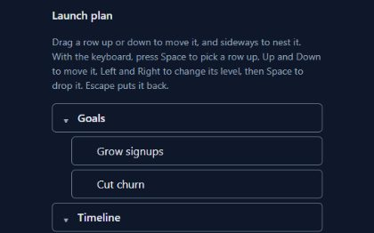</a><br><b>B15</b> <a href="https://az9713.github.io/ui-sdk-gallery/?ui=B15">Outline editor, nest by drag</a><br><sub>Reorder and nest tree items</sub></td>
</tr>
<tr>
<td width="33%" valign="top"><a href="https://az9713.github.io/ui-sdk-gallery/?ui=B16">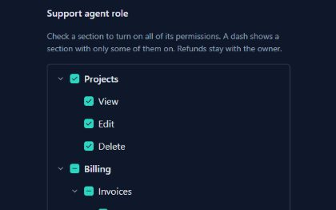</a><br><b>B16</b> <a href="https://az9713.github.io/ui-sdk-gallery/?ui=B16">Permission tree with 3-state boxes</a><br><sub>Checked, unchecked and mixed states from paths</sub></td>
<td width="33%" valign="top"><a href="https://az9713.github.io/ui-sdk-gallery/?ui=B17">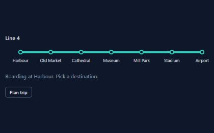</a><br><b>B17</b> <a href="https://az9713.github.io/ui-sdk-gallery/?ui=B17">Metro line map</a><br><sub>1 tab stop on a line of stations, and find a station by typing</sub></td>
<td width="33%" valign="top"><a href="https://az9713.github.io/ui-sdk-gallery/?ui=B18">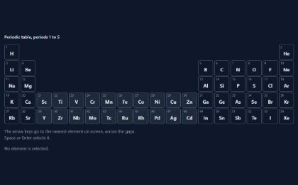</a><br><b>B18</b> <a href="https://az9713.github.io/ui-sdk-gallery/?ui=B18">Periodic table</a><br><sub>Arrow keys choose the next item from its position on screen</sub></td>
</tr>
<tr>
<td width="33%" valign="top"><a href="https://az9713.github.io/ui-sdk-gallery/?ui=B19">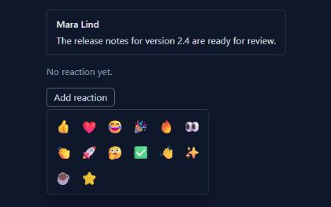</a><br><b>B19</b> <a href="https://az9713.github.io/ui-sdk-gallery/?ui=B19">Emoji picker</a><br><sub>A popup with a flowing grid in it</sub></td>
<td width="33%" valign="top"><a href="https://az9713.github.io/ui-sdk-gallery/?ui=B20">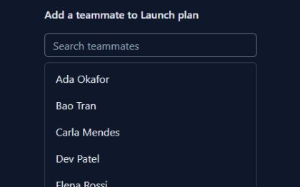</a><br><b>B20</b> <a href="https://az9713.github.io/ui-sdk-gallery/?ui=B20">Teammate picker</a><br><sub>A search box over options. The website's example.</sub></td>
<td width="33%" valign="top"><a href="https://az9713.github.io/ui-sdk-gallery/?ui=B21"></a><br><b>B21</b> <a href="https://az9713.github.io/ui-sdk-gallery/?ui=B21">Upload queue that tells a screen reader its progress</a><br><sub>Astronomy: telescope image frames (FITS) upload to an observatory archive</sub></td>
</tr>
<tr>
<td width="33%" valign="top"><a href="https://az9713.github.io/ui-sdk-gallery/?ui=B22"></a><br><b>B22</b> <a href="https://az9713.github.io/ui-sdk-gallery/?ui=B22">Wizard stepper</a><br><sub>Food: a sourdough bake schedule, 4 steps from starter to bake</sub></td>
<td width="33%" valign="top"><a href="https://az9713.github.io/ui-sdk-gallery/?ui=B23"></a><br><b>B23</b> <a href="https://az9713.github.io/ui-sdk-gallery/?ui=B23">Hold-to-delete button</a><br><sub>Genomics: delete a sequenced DNA sample from a lab freezer list</sub></td>
<td width="33%" valign="top"><a href="https://az9713.github.io/ui-sdk-gallery/?ui=B24"></a><br><b>B24</b> <a href="https://az9713.github.io/ui-sdk-gallery/?ui=B24">Quantity control that repeats</a><br><sub>Coffee: brew ratio, grams of coffee and water</sub></td>
</tr>
<tr>
<td width="33%" valign="top"><a href="https://az9713.github.io/ui-sdk-gallery/?ui=B25"></a><br><b>B25</b> <a href="https://az9713.github.io/ui-sdk-gallery/?ui=B25">Tag list with remove</a><br><sub>Ecology: bird species seen on a field trip, as tags</sub></td>
<td width="33%" valign="top"><a href="https://az9713.github.io/ui-sdk-gallery/?ui=B26"></a><br><b>B26</b> <a href="https://az9713.github.io/ui-sdk-gallery/?ui=B26">Panels that browser search can open</a><br><sub>Chemistry: facts about 8 chemical elements in closed panels</sub></td>
<td width="33%" valign="top"><a href="https://az9713.github.io/ui-sdk-gallery/?ui=B27"></a><br><b>B27</b> <a href="https://az9713.github.io/ui-sdk-gallery/?ui=B27">Sketch pad with undo</a><br><sub>Astronomy: draw constellation lines between stars</sub></td>
</tr>
<tr>
<td width="33%" valign="top"><a href="https://az9713.github.io/ui-sdk-gallery/?ui=B28"></a><br><b>B28</b> <a href="https://az9713.github.io/ui-sdk-gallery/?ui=B28">Theme switch that stays set</a><br><sub>Weather: a 7-day forecast dashboard</sub></td>
<td width="33%" valign="top"><a href="https://az9713.github.io/ui-sdk-gallery/?ui=B29"></a><br><b>B29</b> <a href="https://az9713.github.io/ui-sdk-gallery/?ui=B29">Cookie consent bar</a><br><sub>Games: a retro arcade landing page</sub></td>
<td width="33%" valign="top"><a href="https://az9713.github.io/ui-sdk-gallery/?ui=B30"></a><br><b>B30</b> <a href="https://az9713.github.io/ui-sdk-gallery/?ui=B30">Draft form that survives a reload</a><br><sub>Outdoors: a hiking trip planner</sub></td>
</tr>
<tr>
<td width="33%" valign="top"><a href="https://az9713.github.io/ui-sdk-gallery/?ui=B31"></a><br><b>B31</b> <a href="https://az9713.github.io/ui-sdk-gallery/?ui=B31">Font picker with a preview</a><br><sub>Typography: a gig poster</sub></td>
<td width="33%" valign="top"><a href="https://az9713.github.io/ui-sdk-gallery/?ui=B32"></a><br><b>B32</b> <a href="https://az9713.github.io/ui-sdk-gallery/?ui=B32">Card deck that you flick</a><br><sub>Botany: plant identification cards</sub></td>
<td width="33%" valign="top"><a href="https://az9713.github.io/ui-sdk-gallery/?ui=B33"></a><br><b>B33</b> <a href="https://az9713.github.io/ui-sdk-gallery/?ui=B33">Phone bottom sheet with a text field</a><br><sub>Transit: a ride request on a city map</sub></td>
</tr>
<tr>
<td width="33%" valign="top"><a href="https://az9713.github.io/ui-sdk-gallery/?ui=B34"></a><br><b>B34</b> <a href="https://az9713.github.io/ui-sdk-gallery/?ui=B34">Toolbar that follows a text selection</a><br><sub>Literature: annotate a poem</sub></td>
<td width="33%" valign="top"><a href="https://az9713.github.io/ui-sdk-gallery/?ui=B35"></a><br><b>B35</b> <a href="https://az9713.github.io/ui-sdk-gallery/?ui=B35">Piano keyboard</a><br><sub>Music: play a melody</sub></td>
<td width="33%" valign="top"><a href="https://az9713.github.io/ui-sdk-gallery/?ui=B36"></a><br><b>B36</b> <a href="https://az9713.github.io/ui-sdk-gallery/?ui=B36">Crossword grid</a><br><sub>Word games: a daily crossword</sub></td>
</tr>
<tr>
<td width="33%" valign="top"><a href="https://az9713.github.io/ui-sdk-gallery/?ui=B37"></a><br><b>B37</b> <a href="https://az9713.github.io/ui-sdk-gallery/?ui=B37">Shortcut recorder</a><br><sub>Video editing: shortcuts of a timeline editor</sub></td>
<td width="33%" valign="top"><a href="https://az9713.github.io/ui-sdk-gallery/?ui=B38"></a><br><b>B38</b> <a href="https://az9713.github.io/ui-sdk-gallery/?ui=B38">File finder with fuzzy search</a><br><sub>Software: files of a code repository</sub></td>
<td width="33%" valign="top"><a href="https://az9713.github.io/ui-sdk-gallery/?ui=B39"></a><br><b>B39</b> <a href="https://az9713.github.io/ui-sdk-gallery/?ui=B39">Table with columns that resize and reorder</a><br><sub>Finance: stock quotes and fundamentals</sub></td>
</tr>
<tr>
<td width="33%" valign="top"><a href="https://az9713.github.io/ui-sdk-gallery/?ui=B40"></a><br><b>B40</b> <a href="https://az9713.github.io/ui-sdk-gallery/?ui=B40">Media player with 2 control areas</a><br><sub>Audio: a vinyl record player for a podcast or album</sub></td>
</tr>
</table>

### Set C: 2 behaviors that the package does not ship (4)

<table>
<tr>
<td width="33%" valign="top"><a href="https://az9713.github.io/ui-sdk-gallery/?ui=C01"></a><br><b>C01</b> <a href="https://az9713.github.io/ui-sdk-gallery/?ui=C01">First UI of new behavior 1</a><br><sub>Finance: a candlestick price chart</sub></td>
<td width="33%" valign="top"><a href="https://az9713.github.io/ui-sdk-gallery/?ui=C02"></a><br><b>C02</b> <a href="https://az9713.github.io/ui-sdk-gallery/?ui=C02">Second UI of new behavior 1</a><br><sub>Earth science: a seismograph timeline of earthquakes</sub></td>
<td width="33%" valign="top"><a href="https://az9713.github.io/ui-sdk-gallery/?ui=C03"></a><br><b>C03</b> <a href="https://az9713.github.io/ui-sdk-gallery/?ui=C03">First UI of new behavior 2</a><br><sub>Audio: a synth panel of rotary knobs</sub></td>
</tr>
<tr>
<td width="33%" valign="top"><a href="https://az9713.github.io/ui-sdk-gallery/?ui=C04"></a><br><b>C04</b> <a href="https://az9713.github.io/ui-sdk-gallery/?ui=C04">Second UI of new behavior 2</a><br><sub>Geography: a 3D globe that rotates to a city</sub></td>
</tr>
</table>

### Set D: 1 primitive through 4 framework adapters (5)

<table>
<tr>
<td width="33%" valign="top"><a href="https://az9713.github.io/ui-sdk-gallery/?ui=D01"></a><br><b>D01</b> <a href="https://az9713.github.io/ui-sdk-gallery/?ui=D01">Teammate picker in React</a><br><sub>The primitive of B20 through the React adapter</sub></td>
<td width="33%" valign="top"><a href="https://az9713.github.io/ui-sdk-gallery/?ui=D02"></a><br><b>D02</b> <a href="https://az9713.github.io/ui-sdk-gallery/?ui=D02">Teammate picker in Vue</a><br><sub>The primitive of B20 through the Vue adapter</sub></td>
<td width="33%" valign="top"><a href="https://az9713.github.io/ui-sdk-gallery/?ui=D03"></a><br><b>D03</b> <a href="https://az9713.github.io/ui-sdk-gallery/?ui=D03">Teammate picker in Svelte</a><br><sub>The primitive of B20 through the Svelte adapter</sub></td>
</tr>
<tr>
<td width="33%" valign="top"><a href="https://az9713.github.io/ui-sdk-gallery/?ui=D04"></a><br><b>D04</b> <a href="https://az9713.github.io/ui-sdk-gallery/?ui=D04">Teammate picker in Solid</a><br><sub>The primitive of B20 through the Solid adapter</sub></td>
<td width="33%" valign="top"><a href="https://az9713.github.io/ui-sdk-gallery/?ui=D05"></a><br><b>D05</b> <a href="https://az9713.github.io/ui-sdk-gallery/?ui=D05">5 renderings on 1 page with 1 bridge</a><br><sub>1 snapshot lists the 5 pickers</sub></td>
</tr>
</table>

### Set E: UI A01 with 5 different looks (5)

<table>
<tr>
<td width="33%" valign="top"><a href="https://az9713.github.io/ui-sdk-gallery/?ui=E01"></a><br><b>E01</b> <a href="https://az9713.github.io/ui-sdk-gallery/?ui=E01">A01 with no stylesheet</a><br><sub>The parts work with no design</sub></td>
<td width="33%" valign="top"><a href="https://az9713.github.io/ui-sdk-gallery/?ui=E02"></a><br><b>E02</b> <a href="https://az9713.github.io/ui-sdk-gallery/?ui=E02">A01 with web.css defaults</a><br><sub>The starter stylesheet with its own tokens</sub></td>
<td width="33%" valign="top"><a href="https://az9713.github.io/ui-sdk-gallery/?ui=E03"></a><br><b>E03</b> <a href="https://az9713.github.io/ui-sdk-gallery/?ui=E03">A01 with a second token set</a><br><sub>A light, compact theme from tokens only. No selector is written.</sub></td>
</tr>
<tr>
<td width="33%" valign="top"><a href="https://az9713.github.io/ui-sdk-gallery/?ui=E04"></a><br><b>E04</b> <a href="https://az9713.github.io/ui-sdk-gallery/?ui=E04">A01 with an own stylesheet</a><br><sub>Styles on data-slot and state attributes. No web.css.</sub></td>
<td width="33%" valign="top"><a href="https://az9713.github.io/ui-sdk-gallery/?ui=E05"></a><br><b>E05</b> <a href="https://az9713.github.io/ui-sdk-gallery/?ui=E05">A01 in high contrast and reduced motion</a><br><sub>Operating-system display modes</sub></td>
</tr>
</table>

### Set F: Agent use (16)

<table>
<tr>
<td width="33%" valign="top"><a href="https://az9713.github.io/ui-sdk-gallery/?ui=F01"></a><br><b>F01</b> <a href="https://az9713.github.io/ui-sdk-gallery/?ui=F01">Deploy form that 1 act call fills</a><br><sub>Space: a rocket launch configuration form</sub></td>
<td width="33%" valign="top"><a href="https://az9713.github.io/ui-sdk-gallery/?ui=F02"></a><br><b>F02</b> <a href="https://az9713.github.io/ui-sdk-gallery/?ui=F02">Country list with 5,000 options</a><br><sub>Astronomy: a catalogue of 5,000 stars</sub></td>
<td width="33%" valign="top"><a href="https://az9713.github.io/ui-sdk-gallery/?ui=F03"></a><br><b>F03</b> <a href="https://az9713.github.io/ui-sdk-gallery/?ui=F03">Page with 150 controls</a><br><sub>Audio: a 150-control mixing console</sub></td>
</tr>
<tr>
<td width="33%" valign="top"><a href="https://az9713.github.io/ui-sdk-gallery/?ui=F04"></a><br><b>F04</b> <a href="https://az9713.github.io/ui-sdk-gallery/?ui=F04">Team settings: 24 members, row menus, confirm dialog</a><br><sub>Team settings (fixed: same shape as Vercel's benchmark screen)</sub></td>
<td width="33%" valign="top"><a href="https://az9713.github.io/ui-sdk-gallery/?ui=F05"></a><br><b>F05</b> <a href="https://az9713.github.io/ui-sdk-gallery/?ui=F05">Tool console</a><br><sub>Space robotics: a Mars rover command console</sub></td>
<td width="33%" valign="top"><a href="https://az9713.github.io/ui-sdk-gallery/?ui=F06"></a><br><b>F06</b> <a href="https://az9713.github.io/ui-sdk-gallery/?ui=F06">WebMCP registration</a><br><sub>Smart home: devices on a floor plan, registered as WebMCP tools</sub></td>
</tr>
<tr>
<td width="33%" valign="top"><a href="https://az9713.github.io/ui-sdk-gallery/?ui=F07"></a><br><b>F07</b> <a href="https://az9713.github.io/ui-sdk-gallery/?ui=F07">Size picker</a><br><sub>Apparel: a shoe size picker</sub></td>
<td width="33%" valign="top"><a href="https://az9713.github.io/ui-sdk-gallery/?ui=F08"></a><br><b>F08</b> <a href="https://az9713.github.io/ui-sdk-gallery/?ui=F08">Stepper with hidden content</a><br><sub>Chemistry: a lab procedure in steps</sub></td>
<td width="33%" valign="top"><a href="https://az9713.github.io/ui-sdk-gallery/?ui=F09"></a><br><b>F09</b> <a href="https://az9713.github.io/ui-sdk-gallery/?ui=F09">Field that matters only with an error</a><br><sub>Health: a medication dose calculator</sub></td>
</tr>
<tr>
<td width="33%" valign="top"><a href="https://az9713.github.io/ui-sdk-gallery/?ui=F10"></a><br><b>F10</b> <a href="https://az9713.github.io/ui-sdk-gallery/?ui=F10">Two labels that collide</a><br><sub>Restaurant: split a bill (fixed labels Tip and Custom tip)</sub></td>
<td width="33%" valign="top"><a href="https://az9713.github.io/ui-sdk-gallery/?ui=F11"></a><br><b>F11</b> <a href="https://az9713.github.io/ui-sdk-gallery/?ui=F11">Measurement board for all UIs</a><br><sub>Measurement: snapshot bytes against accessibility-tree bytes of each UI</sub></td>
<td width="33%" valign="top"><a href="https://az9713.github.io/ui-sdk-gallery/?ui=F12"></a><br><b>F12</b> <a href="https://az9713.github.io/ui-sdk-gallery/?ui=F12">Pay button</a><br><sub>Concerts: buy a ticket</sub></td>
</tr>
<tr>
<td width="33%" valign="top"><a href="https://az9713.github.io/ui-sdk-gallery/?ui=F13"></a><br><b>F13</b> <a href="https://az9713.github.io/ui-sdk-gallery/?ui=F13">Tax ID and card fields</a><br><sub>Fintech: tax ID and card details</sub></td>
<td width="33%" valign="top"><a href="https://az9713.github.io/ui-sdk-gallery/?ui=F14"></a><br><b>F14</b> <a href="https://az9713.github.io/ui-sdk-gallery/?ui=F14">Recovery codes</a><br><sub>Security: a vault of recovery codes</sub></td>
<td width="33%" valign="top"><a href="https://az9713.github.io/ui-sdk-gallery/?ui=F15"></a><br><b>F15</b> <a href="https://az9713.github.io/ui-sdk-gallery/?ui=F15">Region rule</a><br><sub>Data residency: choose storage regions</sub></td>
</tr>
<tr>
<td width="33%" valign="top"><a href="https://az9713.github.io/ui-sdk-gallery/?ui=F16"></a><br><b>F16</b> <a href="https://az9713.github.io/ui-sdk-gallery/?ui=F16">Audit log with undo</a><br><sub>Whiteboard: collaborative diagram edits</sub></td>
</tr>
</table>

### Set X: Comparison builds without UI SDK (3)

<table>
<tr>
<td width="33%" valign="top"><a href="https://az9713.github.io/ui-sdk-gallery/?ui=X01"></a><br><b>X01</b> <a href="https://az9713.github.io/ui-sdk-gallery/?ui=X01">A01 with no UI SDK</a><br><sub>The comparison build of A01: same request, plain HTML and script</sub></td>
<td width="33%" valign="top"><a href="https://az9713.github.io/ui-sdk-gallery/?ui=X02"></a><br><b>X02</b> <a href="https://az9713.github.io/ui-sdk-gallery/?ui=X02">B01 with no UI SDK</a><br><sub>The comparison build of B01: same request, plain HTML and script</sub></td>
<td width="33%" valign="top"><a href="https://az9713.github.io/ui-sdk-gallery/?ui=X03"></a><br><b>X03</b> <a href="https://az9713.github.io/ui-sdk-gallery/?ui=X03">B17 with no UI SDK</a><br><sub>The comparison build of B17: same request, plain HTML and script</sub></td>
</tr>
</table>

<!-- grid:end -->

## Run it

Tested on Windows 11 with Node `v22.22.0`. `npm ci` prints an `EBADENGINE` warning for this version, because `jsdom` asks for `^22.22.2`, `^24.15.0` or `>=26.0.0`.

```
npm ci
npm run build
```

Then open `dist/index.html` in Chrome. A web server is not necessary. Add `?ui=C04` to the address to open 1 UI. `dist/gallery.js` is about 4.3 MB.

| Command | Use |
| --- | --- |
| `npm run rows` | Check `rows.json` against the installed packages. `npm run rows -- B06` prints 1 row. |
| `npm test` | Run the Vitest suite. See "Known limits". |
| `npm run gate -- B06` | Run the gate on 1 UI. |
| `npm run check` | Run the gate on all UIs. |
| `npm run pages` | Write the GitHub Pages site in `docs/` and the grid of this README. |

The gate needs 2 programs that `npm ci` does not install: Google Chrome (set `CHROME` if it is not in the default Windows folder) and the detector of the `impeccable` skill (set `IMPECCABLE` to its path).

## The gate

| Stage | What it checks |
| --- | --- |
| source | The files, and the imports against `rows.json` |
| types | `tsc` on the files of the UI |
| tests | Vitest, with required test names |
| build | A build that holds only that UI |
| browser | Console, snapshot labels, Tab walk, axe WCAG A and AA, a scripted agent task, screenshot |
| design | `impeccable detect` with 0 findings (A09 has 1 recorded exception) |
| breaks | For layer 1 and 2 UIs: each deliberate break must make its named test fail |

## A measurement

This is a measurement of this gallery, not a Vercel benchmark. It covers 99 UIs in their first state after mount. F11 and the 3 comparison builds are not in it.

| | Median bytes |
| --- | --- |
| Bridge snapshot, `agent.snapshot()` | 478 |
| Accessibility tree as text, 1 line for each node | 620 |

The snapshot is smaller in 62 of the 99 UIs. It is larger or equal in the other 37. Thus the bridge does not always send less text than the accessibility tree.

## Known limits

- `npm test` exits with code 1 on a fresh clone: 1,072 tests pass and 1 test is an expected failure, but Vitest reports 8 unhandled errors. All 8 come from `ui/B25-tag-list.test.ts`: `ReferenceError: WebKitCSSMatrix is not defined`, from `d3` in `jsdom`.
- The gate does not check layout, a screen reader, a real phone or touch input. axe checks contrast only in the first state.
- Some behaviors were checked only in `jsdom`, not in a real browser.
- With the Vue, Svelte and Solid adapters, the empty part shows under a full list at mount (seen in `jsdom` only). Each of those UI files has a workaround.
- The C03 and C04 arrow keys do not mirror in right-to-left text.
- The test in `ui/A23-flight-search.test.ts` uses real waits of 260 ms and can fail on a slow computer.

## Files

| Path | Contents |
| --- | --- |
| `ui/` | 2 files for each UI: the UI and its tests |
| `src/` | The page shell, the 2 new behaviors and test helpers |
| `scripts/` | Build, gate, rows, review and pages scripts |
| `docs/` | The GitHub Pages site: the gallery, the review grid, 2 pages and the thumbnails |
| `shots/`, `results/` | The screenshot and the gate numbers of each UI |
| `BUILDER.md`, `IMPLEMENTATION.md` | The instructions that the builder agents and the orchestrator followed |

Claude Code agents built the gallery. The commit messages name the models in their `Co-Authored-By` lines.
